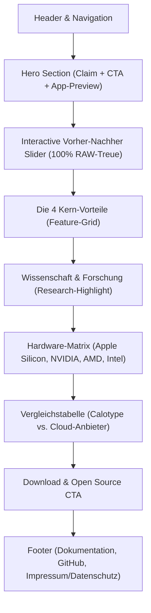

# Calotype — Webdesign- & Landing-Page-Konzept (`calotype.xyz`)

Dieses Dokument definiert die Informationsarchitektur, das UI/UX-Design, die Textinhalte (Copywriting) und die visuelle Identität für die offizielle Landing Page von **Calotype**.

---

## 0. Vor der Umsetzung in Etch

* **Anrede:** du, überall (wie im Plugin).
* **Nur zeigen, was es gibt:** Lightroom-Plugin, Lernen aus den eigenen Bearbeitungen des Shoots, Culling, Retusche über KI-Masken, Begradigen, eigene Looks (CC0), Ordner-Modus ohne Lightroom. Geplant (Hardware-Engine, Serien-Glättung, Desktop-Training) nur als „Roadmap“ kennzeichnen.
* **Zahlen nur aus eigenen Messungen** (`CLAUDE.md`, `tools/eval/`) mit Quelle; Preise anderer Anbieter nur mit Quelle und Datum.
* **Farben:** zuerst eine Markenfamilie (Amber) mit Abstufungen; das Cyan nur, wenn eine Familie nicht reicht.
* **Schriften:** variable Fonts, selbst gehostet (DSGVO) — *Newsreader* (variabel) statt *Instrument Serif* (nicht variabel), dazu *Inter*.
* **Vorher/Nachher-Bild:** aus einem eigenen Shoot mit Freigabe der abgebildeten Personen; keine Kinderfotos.

## 1. Markenidentität & Visuelles Design

### Tonalität & Positioning
* **Wissenschaftlich & Präzise:** Kein Hype, keine „magische KI“-Floskeln. Fundiert auf Computational Photography, Color Science und Peer-Reviewed Research.
* **Profi-Werkzeug:** Entwickelt für anspruchsvolle Hochzeits-, Porträt- und Event-Fotografen.
* **Privatsphäre & Souveränität:** 100 % lokal, Zero-Cloud, DSGVO-konform.

### Farbpalette (Darkroom Aesthetic)
* **Background Primary:** `#0B0D11` (Deep Charcoal / Dunkelkammer-Schwarz)
* **Background Secondary / Cards:** `#151921` (Subtiles Dunkelgrau mit Blaustich)
* **Borders / Separators:** `#262C38` (Feine Konturen)
* **Accent Primary:** `#E6A23C` (Warmes Amber / Bernstein / Retusche-Licht)
* **Accent Cyan / Tech:** `#38BDF8` (Präzisions-Blau für Wissenschaft & NPU-Beschleunigung)
* **Text Main:** `#F3F4F6` (Klares Off-White)
* **Text Muted:** `#9CA3AF` (Dezentes Neutralgrau)

### Typografie
* **Headlines:** *Instrument Serif* oder *Newsreader* (zeitlose, hochwertige Foto-Ästhetik) kombiniert mit *Geist Sans* oder *Inter* für Tech-Sublines.
* **Body / Tech Specs:** *Inter* / *JetBrains Mono* für Parameter, Slider-Werte und Code.

---

## 2. Seiten-Architektur (Wireframe & Sections)

---

## 3. Detail-Ausarbeitung der Sections

### Section 1: Header & Navigation
* **Logo:** Schlichtes, elegantes Calotype-Wortzeichen mit stilisiertem Blendenlamellen-Icon.
* **Links:** Features · Forschung & Whitepaper · Hardware-Support · Dokumentation · GitHub
* **CTA Button:** `Auf GitHub ansehen` — bis es einen Installer gibt (heute: Plugin 0.3.0, Bridge und Server aus dem Quellcode).

### Section 2: Hero Section
* **Badge (oben):** `Open Source · für Lightroom Classic`
* **Headline:** **Die offene KI-Dunkelkammer für Profi-Fotografen.**
* **Subline:** Entwickelt und sortiert deine RAW-Fotos in deinem Stil — **auf deinem eigenen Rechner**. Gelernt aus deinen eigenen Bearbeitungen. **Keine Bild-Credits, keine Cloud-Uploads, null Abo-Kosten.**
* **Buttons:**
  1. Primary CTA: `Lightroom Plugin & App herunterladen` (Kostenlos)
  2. Secondary CTA: `Whitepaper lesen (docs/RESEARCH.md)`

### Section 3: Interaktiver Vorher / Nachher Vergleich (Live-Slider)
* **Visuelles Modul:** Ein interaktiver Vorher-Nachher-Split-Slider eines echten Hochzeits-RAWs (`CR2` / `CR3`):
  * **Links (RAW out of camera):** Neutral, flach, unkorrigierte Farbtemperatur.
  * **Rechts (Calotype, Look aus den eigenen Beispielen des Shoots):** die echten Reglerwerte dieses Fotos (Belichtung, Weißabgleich, Tiefen, Struktur, Gradationskurve) — Beispielfoto und Werte aus einem eigenen, freigegebenen Shoot.
* **HUD-Overlay:** Einblendung der echten Lightroom-Reglerwerte, damit Fotografen sofort verstehen: *„Das sind echte Regler, kein Pixel-Matsch!“*

### Section 4: Die 4 wissenschaftlichen Kern-Vorteile
1. **Echte Regler statt Pixel:** Ergebnis sind Lightroom-Einstellungen, die man lesen und ändern kann (Hu et al., *Exposure*, ACM TOG 2018; Moran et al., *DeepLPF*, CVPR 2020).
2. **Lernt deinen Stil aus deinen Bearbeitungen:** 20–30 bearbeitete Fotos eines Shoots reichen als Beispiele (eigene Messungen, siehe `docs/RESEARCH.md`).
3. **Einheitliche Serien (geplant):** Fotos mit gleichem Inhalt werden aneinander angeglichen, die eigenen Beispiele bleiben fest (HaCohen et al., SIGGRAPH 2013). Erst nennen, wenn gebaut und gemessen.
4. **100 % DSGVO & Zero-Cloud:** Local-First. Kein Bild verlässt deinen Rechner, solange der Calotype-Server bei dir läuft.

### Section 5: Hardware-Kompatibilität (geplant, Phase 8.1 — erst zeigen, wenn gebaut und gemessen)
* **Apple Silicon (M1 bis M5 / Pro / Max):** CoreML & Metal Acceleration.
* **NVIDIA GeForce RTX (20/30/40/50er):** TensorRT & CUDA.
* **AMD Radeon & Intel Arc / Iris Xe:** DirectML über DirectX 12.
* **Intel Core Ultra & Snapdragon X Elite:** Volle NPU-Unterstützung.

### Section 6: Der Vergleich (Calotype vs. Cloud-Tools)
* Kosten: 100 % Kostenlos vs. 0,04 €–0,08 € / Foto oder teures Abo
* Datenschutz: 100 % Lokal vs. Cloud-Upload
* Geschwindigkeit: lokal, ohne Upload (Zahl erst nach Messung auf echter Hardware)
* Anpassbarkeit: Eigene Presets & Stile frei modulierbar vs. starre Black-Box
